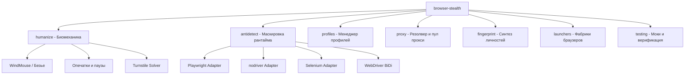

# browser-stealth

**browser-stealth** — специализированная библиотека глубокой маскировки рантайма браузеров, биомеханики поведения человека (WindMouse, кривые Безье, тач-события), управления профилями и умной маршрутизации прокси.

Разработана для надежной автоматизации и парсинга современных веб-приложений под защитой антифрод-систем (Cloudflare Turnstile, DataDome, Akamai, reCAPTCHA, FingerprintJS Pro).

---

## Ключевые возможности

* 🐭 **Физическая модель движения курсора (WindMouse):** Непрерывная симуляция движений кисти человека с гравитационным притяжением, мышечным шумом и физиологическим замедлением перед кликом.
* ✍️ **Биомеханический ввод текста:** Естественные интервалы между нажатиями клавиш (Jitter Delay), симуляция опечаток и их последующее стирание клавишей Backspace.
* 📱 **Мобильные тач-жесты:** Эмуляция `touch_tap` и `touch_swipe` с микроколебаниями контакта и сглаженной физикой скролла.
* 🛡️ **Мульти-движковый антидетект:**
    * **Playwright:** Скрытые runtime CDP-инъекции, патчинг `navigator.webdriver`, плагинов, разрешений экрана и WebGL.
    * **nodriver:** Автономный Chrome без классического WebDriver протокола и флаги глубокой маскировки.
    * **Selenium:** Патчинг CDP через Page.addScriptToEvaluateOnNewDocument.
    * **WebDriver BiDi:** Прямая маскировка через современный двунаправленный протокол W3C BiDi.
    * **Camoufox:** Встроенная поддержка патченного C++ Firefox с защитой на уровне бинарника.
* 🧩 **Решение Cloudflare Turnstile:** Автоматическое обнаружение виджета, наведение курсора по траектории WindMouse и естественный клик.
* 🎭 **Синтезатор цифровой личности (Fingerprint Synthesizer):** Детерминированная процедурная генерация непротиворечивых аппаратных профилей (GPU, ANGLE D3D11, дисплеи, аудио-джиттер) и поддержка байесовской ML-модели `browserforge`.
* 📁 **Менеджер изолированных профилей:** Поддержка постоянных сессий (cookies, IndexedDB, localStorage), детекция зависших lock-файлов и санитайзинг crash-состояний (`Preferences`, `Local State`).
* 🌐 **Умный резолвер прокси:** Автоматический разбор колоночных и URL форматов, предварительное активное TCP/HTTP зондирование и дисковый кэш.
* 🧪 **Автономное тестирование:** Локальный mock HTTP-сервер, верификация экстракций и заглушки для запуска тестов без реального браузера.

---

## Архитектура модулей

